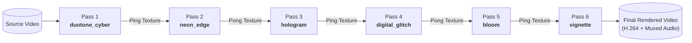
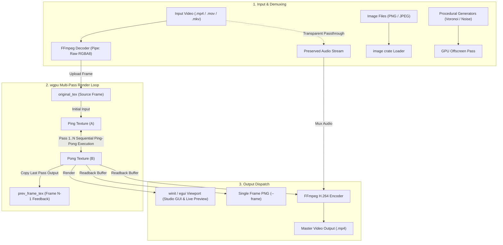

# ninja-shader 🥷🎬

[](https://www.rust-lang.org/)
[](https://wgpu.rs/)
[](LICENSE)
[](https://github.com/leouofa/ninja-shader/releases)
[](#installation--requirements)
[](#shader-library-contract-abi)

> **GPU-accelerated video shader processing pipeline & live creative studio in Rust using `wgpu` and FFmpeg.**

`ninja-shader` is a high-performance creative desktop studio and CLI toolchain for chaining and hot-reloading GPU fragment shaders across video streams in real time. Designed for creative technologists, video editors, and graphics engineers, it bridges low-level hardware rendering pipelines with an interactive, hot-reloading desktop UI and lossless production video export.


*Sample frame rendered using the 6-pass `ultimate_cyberpunk` recipe (`duotone_cyber` → `neon_edge` → `hologram` → `digital_glitch` → `bloom` → `vignette`).*

---

## Key Capabilities

- ⚡ **Sub-Millisecond Multi-Pass GPU Engine**: Chain arbitrary sequences of reusable WGSL and GLSL fragment shaders in series. Framebuffers alternate across ping-pong textures with zero CPU-GPU copy bottlenecks.
- 🎛️ **Native Desktop Studio GUI (`egui` + `wgpu`)**: Full-featured interactive studio featuring video scrubbing, playback controls, live uniform sliders, keyboard-driven recipe hot-swapping, and non-blocking background video export.
- 🔥 **Instant Live Hot-Reloading**: Integrated file watcher (`notify`) recompiles shaders and updates parameters on the fly the moment you save your file—never pause or restart playback to iterate.
- 🔊 **Lossless Audio Passthrough**: High-throughput FFmpeg pipe streaming decodes video frames to raw RGBA8 while transparently muxing the original multichannel audio stream back into the rendered output.
- ⏳ **Temporal Feedback & Motion Buffers**: Direct shader access to previous frame outputs (`prev_frame_tex`) and unmodified source video (`original_tex`), enabling analog datamosh, phosphor decay, and persistent echo trails.
- 🌐 **Dual Language ABI (WGSL + GLSL)**: Write shaders in modern WebGPU Shading Language (`.wgsl`) or Vulkan GLSL (`.glsl`). Naga transparently compiles both to native Metal (macOS), Vulkan (Linux), or DirectX 12 (Windows).
- 📦 **Declarative Sidecar Manifests**: Every shader is paired with a `<name>.toml` manifest specifying strongly typed uniform parameters (`float`, `int`, `vec2`, `vec3`, `vec4`, `color`), ranges, defaults, and custom auxiliary textures.
- 🌀 **Procedural & Generative GPU Textures**: Native GPU generation for Voronoi cellular diagrams and Simplex/Perlin/FBM noise. Bind procedural textures to shaders like `texture_overlay` with full control over seeds, scale, jitter, metrics, modes, and time animation.
- 🧰 **Complete Shader Toolchain**: Built-in CLI commands to scaffold new shaders, inspect parameter ABIs, discover available effects, and validate pipelines headlessly in CI/CD.

---

## Studio GUI & Creator Workflow

Launch the native studio interface with a single command:

```bash
cargo run --release -- gui -i input.mp4 -p pipelines/retro_crt.toml
```

```
┌─────────────────────────────────────────────────────────────────────────────┐
│ 🥷 ninja-shader Studio                                                      │
├───────────────────────┬─────────────────────────────────────────────────────┤
│ 📁 Video & Output     │                                                     │
│ [Open Video...]       │                 VIEWPORT DISPLAY                    │
│ [Set Output Dir...]   │             (Zero-Latency GPU Canvas)               │
├───────────────────────┤                                                     │
│ 📜 Pipeline Recipes   │                                                     │
│ > retro_crt           │                                                     │
│   synthwave_outrun    │                                                     │
│   ultimate_cyberpunk  ├─────────────────────────────────────────────────────┤
│   matrix_terminal     │ ▶ [Play]  00:04.12 / 00:15.00 [===========-------] │
├───────────────────────┼─────────────────────────────────────────────────────┤
│ 🎚️ Shader Parameters  │ 🚀 Export Queue                                     │
│ [Pass 1: Scanlines]   │ [Render Video]   Progress: [=============>] 68%     │
│   curvature: ──●──    │ Output: output/retro_crt.mp4 (48.2 FPS)             │
│   intensity: ────●    │                                                     │
└───────────────────────┴─────────────────────────────────────────────────────┘
```

### Creator Workflow Highlights

- **Live Recipe Hot-Swapping**: Select the pipeline list and press the **`↑` / `↓` arrow keys** to switch instantly between 53 included pipeline recipes while video plays seamlessly.
- **Real-Time Parameter & Texture Tuning**: Drag sliders and color pickers for any active pass. For texture-enabled shaders (like `texture_overlay`), switch texture slots dynamically between `📁 File` (with a native "Browse..." file picker), `🌀 Voronoi` (with seed slider and "🎲 Roll" randomizer), or `🌊 Noise / FBM`.
- **Non-Blocking Background Export**: Click **Render Video** to kick off an asynchronous background render. An animated progress bar tracks completion percentage, rendered frames, and export FPS without dropping preview framerates.
- **Interactive Preview Controls**:
  - `Space` — Toggle Play / Pause
  - `R` — Restart playback from frame 0
  - `S` — Export current processed frame as an uncompressed PNG screenshot
  - `↑` / `↓` — Step through recipes in Studio GUI
  - `Esc` / `Q` — Close window

---

## 30-Second Quickstart

### 1. Requirements

Ensure `ffmpeg` and `ffprobe` are installed on your system:

```bash
# macOS
brew install ffmpeg

# Ubuntu / Debian
sudo apt update && sudo apt install -y ffmpeg

# Windows (Chocolatey)
choco install ffmpeg
```

### 2. Build & Launch

#### Quick Developer Install (Symlink)
To build the release binary and symlink `ninja-shader` into your PATH:

```bash
./scripts/install.sh
```

#### Manual Build
```bash
# Clone repository
git clone https://github.com/leouofa/ninja-shader.git
cd ninja-shader

# Build release binary
cargo build --release

# Launch Studio GUI with sample video
./target/release/ninja-shader gui -i test_input.mp4
```

### 3. CLI Video Rendering

Render a full multi-pass pipeline directly from the terminal:

```bash
./target/release/ninja-shader render \
  --pipeline pipelines/retro_crt.toml \
  -i input.mp4 \
  -o output.mp4 \
  --crf 18
```

---

## Visual Recipes & Effect Showcase

Pipelines are declared in simple, human-readable TOML files that chain any combination of shaders in series:



### Curated Creative Effect Library (35 Built-In Shaders)

#### 👾 1. Cyberpunk, Glitch & Datamosh
| Shader | Lang | Description & Creative Applications |
| :--- | :---: | :--- |
| `digital_glitch` | WGSL | Scan-band slice tearing, random block displacement, and chroma shifts |
| `glitch_displacement` | WGSL | Pseudo-random horizontal slice displacement bands with chromatic channel drift |
| `datamosh` | WGSL | Macroblock motion-vector smearing and simulated I-frame drops via temporal buffer |
| `pixel_sort` | WGSL | Directional luminance-threshold pixel sorting and streak smearing |
| `rgb_wave` | WGSL | Sinusoidal and sawtooth horizontal wave distortion with phase-offset RGB channels |
| `block_corrupt` | WGSL | MPEG macroblock corruption with UV channel swapping, bit-crushing, and inversion |

#### 🌆 2. Neon, Synthwave & Glow
| Shader | Lang | Description & Creative Applications |
| :--- | :---: | :--- |
| `bloom` | WGSL | Luminance bright-pass extraction with dual-ring Gaussian glow diffusion |
| `edge_glow` | WGSL | 3×3 Sobel edge detection with luminous colored contour glow |
| `neon_edge` | WGSL | 3×3 Sobel gradient edge detection rendered as vibrant, pulsing contours |
| `synthwave_grid` | WGSL | Outrun-style perspective scrolling laser floor grid with horizon haze |
| `duotone_cyber` | WGSL | Stylized split-toning mapping shadows and highlights across custom neon palettes |
| `halation` | WGSL | Red-orange film emulsion halation scatter around high-contrast light sources |

#### 🥽 3. Sci-Fi HUD & Tactical Visors
| Shader | Lang | Description & Creative Applications |
| :--- | :---: | :--- |
| `hologram` | WGSL | Volumetric hologram with raster scanlines, rolling sync bars, and transmission flicker |
| `night_vision` | WGSL | Tactical Gen-3 green phosphor goggles with IR amplification and circular optical mask |
| `thermal_infrared` | WGSL | FLIR false-color thermal heat imaging with ironbow gradients and isotherm contours |
| `radar_hud` | WGSL | Tactical visor overlay with rotating radar sweep, crosshairs, and corner brackets |
| `vhs_tracking` | WGSL | Analog tape tracking errors, tape head-switching static, and horizontal sync jitter |

#### 📺 4. Analog, CRT & Retro Cinema
| Shader | Lang | Description & Creative Applications |
| :--- | :---: | :--- |
| `crt_phosphor_mask` | WGSL | CRT hardware RGB subpixel aperture grille (Trinitron striping) and shadow mask phosphors |
| `vhs_chroma_bleed`| WGSL | YIQ/YUV color-space separation with low-pass horizontal chrominance smearing |
| `crt_scanlines` | WGSL | CRT barrel screen curvature, phosphor scanlines, and vignette bezel |
| `film_grain` | GLSL | Temporal hash-based 35mm film grain noise driven by frame counter & time |
| `ascii_matrix` | WGSL | Procedural digital cellular glyph quantization with falling code rain trails |
| `halftone_cyber` | WGSL | Rotated CMYK / LED dot-matrix halftone screen pattern with variable dot scale |

#### 🛠️ 5. Cinematic Essentials & Utilities
| Shader | Lang | Description & Creative Applications |
| :--- | :---: | :--- |
| `fisheye_lens` | WGSL | Optical fisheye and pincushion lens distortion with focal length and edge vignette |
| `posterize` | WGSL | Color quantization into discrete posterized step bands with gamma and saturation |
| `solarize` | WGSL | Sabattier photographic tone inversion creating metallic surreal highlights |
| `cross_process` | WGSL | Chemical film cross-processing emulation with vivid contrast, cyan shadows, and warm highlights |
| `chromatic_aberration` | GLSL | Radial optical lens prism splitting driven by configurable spread amount |
| `motion_trails` | WGSL | Phosphor decay and ghosting persistence using `prev_frame_tex` feedback |
| `texture_overlay` | WGSL | External image/film dirt pattern blending with adjustable opacity and UV scale |
| `pixelate` | WGSL | Aspect-ratio aware pixel grid quantization with optional color bit-depth crushing |
| `kaleido_prism` | WGSL | Radial N-fold mirror symmetry kaleidoscope distortion with continuous rotation |
| `vignette` | WGSL | Smooth radial edge falloff with intensity, radius, softness, and tint control |
| `grayscale` | WGSL | Rec. 709 luminance desaturation with adjustable blend strength |
| `sepia` | WGSL | Warm vintage photographic toning |

---

## 53 Turnkey Pipeline Recipes

`ninja-shader` includes 53 production-ready recipes in `pipelines/` ready to run out of the box:

| Recipe File | Passes | Visual Aesthetic |
| :--- | :---: | :--- |
| `ultimate_cyberpunk.toml` | 6 | Duotone split → Neon edge → Hologram → Glitch → Bloom → Vignette |
| `voronoi_cyber_cells.toml`| 4 | Procedural GPU Voronoi borders overlay → Duotone split → Bloom → Vignette |
| `trinitron_crt_deluxe.toml`| 5 | Fisheye curvature → CRT phosphor mask → CRT scanlines → Bloom → Vignette |
| `bio_mesh_cellular.toml` | 4 | Manhattan Voronoi cellular lattice → Duotone cyber → Bloom → Vignette |
| `liquid_noise_dream.toml` | 4 | Flowing FBM noise overlay → Chromatic aberration → Halation → Film grain |
| `crystal_fracture.toml` | 4 | Voronoi borders → Luminous edge glow → Chromatic aberration → Vignette |
| `acid_camo_matrix.toml` | 3 | Voronoi cell mosaic → Posterize color quantization → CRT scanlines |
| `quantum_plasma_flux.toml`| 4 | High-speed noise turbulence → Solarize Sabattier → Bloom → Vignette |
| `cyber_samurai.toml` | 4 | Edge glow → Posterize → Duotone cyber → Bloom |
| `hyperspace_warp.toml` | 4 | Fisheye pincushion tunnel → Chromatic aberration → RGB wave → Bloom |
| `matrix_overdrive.toml` | 4 | ASCII matrix rain → Glitch displacement slices → Neon edge → Bloom |
| `technicolor_vintage.toml`| 4 | Chemical cross-process film → Halation scatter → Film grain → Vignette |
| `pop_art_comic.toml` | 3 | Posterize banding → Halftone dot matrix → Inked edge glow |
| `solarized_inferno.toml` | 4 | Solarize inversion → FLIR thermal heat map → Bloom → Vignette |
| `kaleido_dreamscape.toml` | 4 | Hexagonal kaleidoscope prism → Cross process → Bloom → Chromatic aberration |
| `fisheye_security_cam.toml`| 5 | Fisheye CCTV lens → Grayscale → CRT scanlines → Film grain → Vignette |
| `90s_skate_camcorder.toml` | 5 | Death-lens fisheye → Chromatic aberration → Halation → VHS tracking → Grain |
| `pirate_radio_tv.toml` | 4 | Glitch slice displacement → VHS chroma bleed → CRT scanlines → Vignette |
| `deep_space_probe.toml` | 4 | Night vision phosphor → Radar sweep HUD → CRT phosphor mask → Glitch |
| `noir_detective_fisheye.toml`| 4 | Curved peephole fisheye → Monochrome Rec. 709 → Film grain → Deep vignette |
| `retro_crt.toml` | 5 | Chromatic aberration → CRT curvature/scanlines → Trails → Grain → Vignette |
| `synthwave_outrun.toml` | 5 | Duotone → Perspective laser grid → Bloom glow → CRT scanlines → Vignette |
| `matrix_terminal.toml` | 5 | Falling ASCII glyphs → Bloom → CRT scanlines → Motion trails → Vignette |
| `datamosh_breakdown.toml`| 4 | Motion-vector smearing → Macroblock corrupt → Glitch → Chromatic aberration |
| `tactical_nvg.toml` | 5 | Night vision phosphor → Radar HUD overlay → Bloom → Film grain → Vignette |
| `predator_thermal.toml` | 4 | FLIR thermal ironbow → Tactical HUD → CRT scanlines → Chromatic aberration |
| `analog_broadcast_1984.toml`| 5 | VHS chroma smearing → CRT scanlines → Halation → Film grain → Vignette |
| `glitch_art_gallery.toml` | 4 | Pixel sort smearing → Macroblock corruption → RGB wave → Halftone dot matrix |
| `noir_film.toml` | 4 | Rec. 709 black & white → Dirty texture overlay → Film grain → Deep vignette |

*Explore all 53 recipes in [`pipelines/`](pipelines/).*

---

## Engine Architecture Under the Hood



### The Shader Contract (ABI)

Every fragment shader automatically receives a standardized, zero-boilerplate runtime context:

#### Group 0: Video & Timing Context
- `globals.resolution`: `vec2<f32>` — Current frame width and height in pixels
- `globals.inv_resolution`: `vec2<f32>` — Reciprocal pixel step (`1.0 / width`, `1.0 / height`)
- `globals.time`: `f32` — Total elapsed video playback time in seconds
- `globals.delta_time`: `f32` — Elapsed time since previous frame (`1.0 / fps`)
- `globals.frame`: `u32` — Monotonically increasing frame index
- `globals.fps`: `f32` — Video frame rate
- `linear_sampler` & `nearest_sampler` — Built-in hardware texture samplers
- `input_tex` — Output texture from the immediately preceding pass
- `original_tex` — Untouched source video frame for this timestamp
- `prev_frame_tex` — Output of the final pass from the previous frame ($N - 1$)

#### Group 1: Custom Uniforms & Textures
- `params` — Dynamically packed uniform struct matching declarations in `<name>.toml`
- `custom_textures` — Any auxiliary images (PNG/JPEG) or GPU generative textures (Voronoi & Noise) bound from the recipe

### Generative Textures (Voronoi & Noise)

Any shader declaring auxiliary textures (like `texture_overlay`) can bind either a static image file or a procedural GPU-generated texture. In pipeline TOML recipes, define inline generator tables:

```toml
[[passes]]
shader = "texture_overlay"
enabled = true
[passes.params]
opacity = 0.65
uv_scale = 1.0

# Generative Voronoi texture configuration
[passes.textures.overlay_tex]
generator = "voronoi"
seed = 777
scale = 10.0
jitter = 0.85
mode = "borders"       # "distance" (F1) | "borders" (F2 - F1) | "cells" (Cell ID color)
metric = "euclidean"   # "euclidean" | "manhattan"
animate = true         # Evolve pattern over time
speed = 0.8
```

Alternatively, to use an image file, pass a path string (`overlay_tex = "assets/pattern.png"`). In the Studio GUI, you can switch between `📁 File` (with a native "Browse..." file selector), `🌀 Voronoi` (with seed slider, "🎲 Roll" randomizer, mode, and metric controls), and `🌊 Noise / FBM` (with octave, persistence, and lacunarity sliders) in real time.

---

## CLI Command Reference

`ninja-shader` provides a comprehensive command-line suite:

### `gui` — Launch Desktop Studio
```bash
ninja-shader gui [-i <VIDEO>] [-p <PIPELINE>] [-o <OUTPUT_DIR>]
```

### `render` — Process Video or Single Frame
```bash
ninja-shader render --pipeline <PATH> [OPTIONS]

Options:
  -i, --input <PATH>      Override input video file
  -o, --output <PATH>     Override output video / image file
      --frame <N>         Render only frame index N (0-based) to PNG
      --scale <FLOAT>     Resolution scale multiplier (e.g. 0.5 for fast half-res preview)
      --crf <INT>         H.264 CRF quality factor (0-51, default: 18)
      --start <SEC>       Start offset in seconds
      --duration <SEC>    Duration in seconds to process
```

### `preview` — Lightweight Hot-Reloading Viewport
```bash
ninja-shader preview --pipeline pipelines/retro_crt.toml -i input.mp4
```

### `list` — Discover Library Shaders
```bash
ninja-shader list
```

### `inspect` — View Shader ABI & Parameters
```bash
ninja-shader inspect crt_scanlines
```

### `new` — Scaffold a New Shader
```bash
ninja-shader new glitch_blast --lang wgsl
# or for Vulkan GLSL:
ninja-shader new glitch_blast --lang glsl
```
*Generates boilerplate `shaders/glitch_blast.toml` and `shaders/glitch_blast.wgsl` automatically.*

### `validate` — Headless Pipeline Verification
```bash
ninja-shader validate --pipeline pipelines/retro_crt.toml
```
*Compiles all shaders and verifies parameter schemas against the GPU without launching a window.*

---

## Example Pipeline Recipe (`pipelines/retro_crt.toml`)

```toml
name = "retro_crt"
description = "Vintage CRT television with phosphor scanlines and curvature"
input = "test_input.mp4"
output = "output_retro_crt.mp4"

[settings]
scale = 1.0
crf = 18
preset = "medium"
copy_audio = true

[[passes]]
shader = "chromatic_aberration"
enabled = true
[passes.params]
amount = 0.006

[[passes]]
shader = "crt_scanlines"
enabled = true
[passes.params]
curvature = 0.12
scanline_intensity = 0.30
scanline_count = 360.0

[[passes]]
shader = "motion_trails"
enabled = true
[passes.params]
decay = 0.35

[[passes]]
shader = "film_grain"
enabled = true
[passes.params]
intensity = 0.06
size = 1.0

[[passes]]
shader = "vignette"
enabled = true
[passes.params]
intensity = 0.80
radius = 0.75
softness = 0.40
tint = [0.0, 0.0, 0.0]
```

---

## Tech Stack & Architecture Highlights

- **Language**: Modern Rust (2021 Edition)
- **Graphics API**: [`wgpu 24`](https://github.com/gfx-rs/wgpu) (WebGPU implementation running natively over Metal, Vulkan, and DirectX 12)
- **Shader Translation**: [`naga 24`](https://github.com/gfx-rs/wgpu/tree/master/naga) (Cross-compilation for WGSL & GLSL fragment stages)
- **Studio Interface**: [`egui 0.31`](https://github.com/emilk/egui) with `egui-wgpu` and `winit 0.30`
- **Video Processing**: FFmpeg streaming pipes via `std::process::Command` (raw RGBA8 multiplexing & AAC/MP3 audio passthrough)
- **Live File Watcher**: [`notify 6.1`](https://github.com/notify-rs/notify) (Cross-platform filesystem event debouncing)
- **Serialization**: [`serde`](https://serde.rs/) & [`toml`](https://github.com/toml-rs/toml)
- **CLI Framework**: [`clap 4.5`](https://github.com/clap-rs/clap) with derive macros

---

## License

This project is licensed under the [MIT License](LICENSE).
